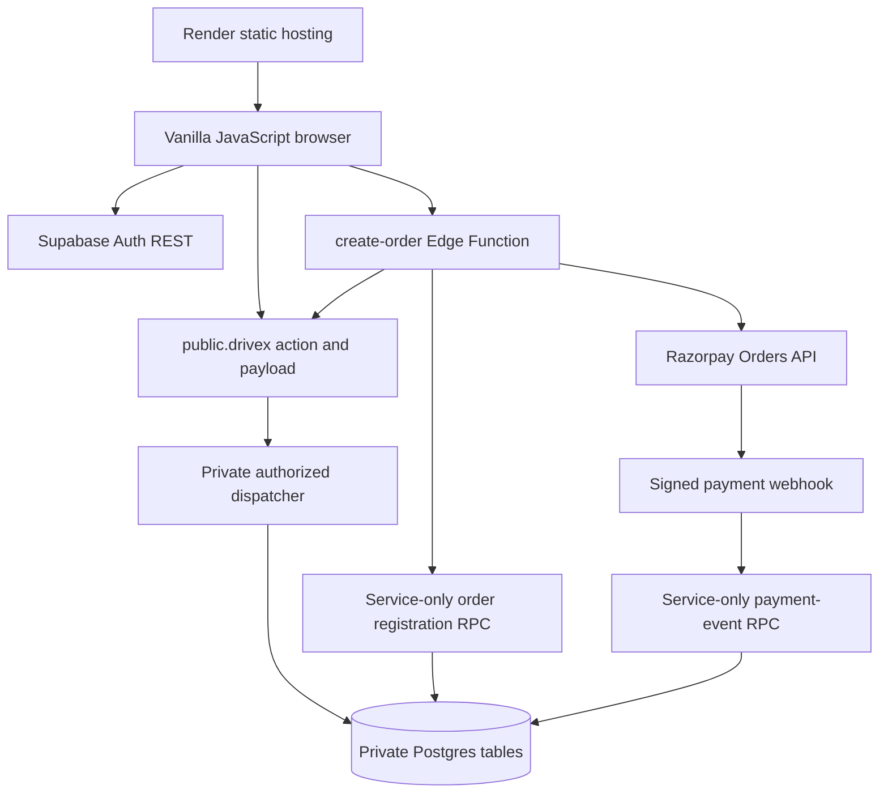

# DriveX architecture and product guide

DriveX serves learners, instructors and school administrators on the existing Supabase / vanilla JavaScript / Render stack. The current product inventory and release boundaries are maintained in [docs/PRODUCT_AUDIT.md](docs/PRODUCT_AUDIT.md). Actual API shapes are maintained in [API_CONTRACT.md](API_CONTRACT.md). Deployment instructions are in [docs/RELEASE.md](docs/RELEASE.md).

## Architecture

The browser stores auth tokens in sessionStorage. It never stores enrollments, bookings or fake inventory as a substitute for the database. A failed snapshot displays a retry/sign-out state. Required role-specific reads must succeed before a new workspace is rendered.

The dispatcher checks `auth.uid()`, reads a protected profile and checks role/row ownership for every action. Pending instructors receive only their account state. Direct table grants remain revoked; private tables have RLS enabled. Security-definer functions use an empty search path and qualified names. Server-only RPCs are explicitly denied to anonymous and authenticated browser roles.

## Business model

| Plan | Price | Credits |
| --- | --- | --- |
| 10-Day | INR 1,500 | 10 |
| Monthly | INR 4,000 | 30 |

An enrollment snapshots the server plan's credits and payment amount. Plan names do not currently introduce calendar expiry. One unfinished enrollment is allowed through the current dispatcher; a repeated identical enrollment request returns the existing pending enrollment. A paid plan remains active until credits are exhausted or an eligible full refund is recorded.

New lessons are immediately reserved against the paid plan. Reserved credits are counted separately from consumed credits so a learner cannot book more lessons than they can complete. Lesson completion consumes a credit exactly once. All reservation/completion operations lock enrollment before booking/payment rows where applicable. Existing GiST exclusion constraints prevent instructor, learner and vehicle time overlaps. Legacy pending lesson holds retain their 30-minute expiration.

Lesson slots are one hour at 08:00, 09:00, 10:00, 11:00, 14:00, 15:00, 16:00 or 17:00, India Standard Time, within 90 days. The enrolled approved instructor is selected by the server. Only active vehicles can receive new bookings. Completed bookings require a 1–10 score and 1–1,500 characters of notes.

Theory/practical completion is stored per learner and curriculum item. Learners mark theory; only the current paid instructor can mark practical. The course has eight theory modules and five practical milestones. Admins supply reviewed HTTPS YouTube video links; none are invented by the client.

## Payment lifecycle

1. Enrollment creates a private payment record with the server's plan price.
2. The order function calls `get_checkout` with the learner's JWT. The dispatcher checks ownership and pending state.
3. The function creates an INR order using server credentials, registers it through a service-only RPC and returns the stored order's public checkout details. Repeated requests reuse the stored order.
4. The webhook checks HMAC-SHA256 over the raw body, takes the provider's event ID from its header and validates the captured/failed state and INR currency.
5. The database locks the enrollment/payment, matches the stored order and amount, deduplicates event/payment IDs and updates the payment/enrollment transactionally. Failed or replayed events cannot undo a paid or refunded record.
6. The browser waits for database status. Its success callback does not grant credits.

Manual receipts are admin-only and require an actual receipt reference. An issued online order must be reconciled before substituting a manual payment. Full-refund records require an unused paid plan with no reserved lessons and a real returned-money reference. The app does not initiate refunds or instructor bank payouts.

## Migration and release status

No previously applied migration is edited. `20261107000100_product_completion.sql` follows `0004` and repairs browser role/payment changes introduced there. It preserves user data and ledger rows, requires fresh instructor approval, deactivates the three exact placeholder vehicles and flags direct/synthetic paid records for review. Read-only preflight checks detect data that needs reconciliation before unique indexes or product invariants can be enforced.

Local tests execute every migration in PGlite, including a populated upgrade fixture, and exercise real dispatcher authorization and credit/payment lifecycles. The HTTP integration test executes the actual API client, payment handlers and database through a local test server; Auth/provider responses are isolated fixtures. Client tests cover escaping, public config validation, payment polling/retries, blocked session storage, session refresh, recovery callbacks and API errors. Syntax checks cover every JavaScript module in the application, tests and shared Edge handlers. CI also scans source and Git history for credential patterns without printing values.

Hosted release remains NOT VERIFIED: Supabase restoration was rejected by the organization's free-project limit; Render had no selected workspace; browser visual QA stopped on a URL-identification error. The GitHub push is withheld until completion. Do not describe local test success as a completed hosted product.
