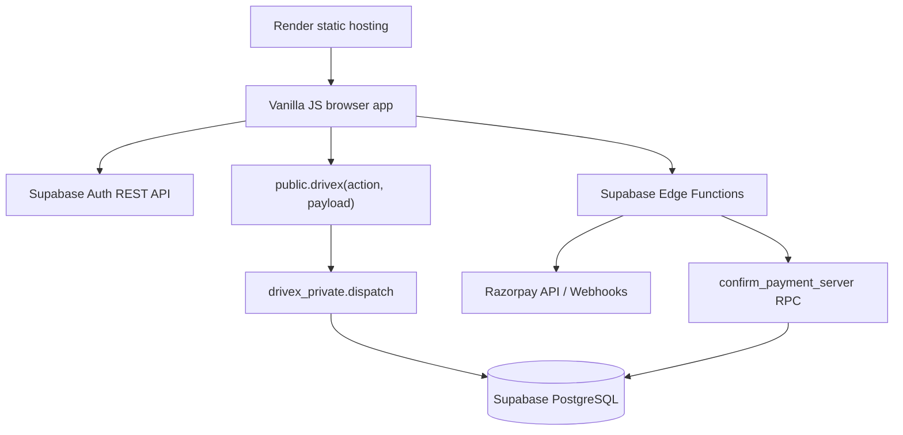
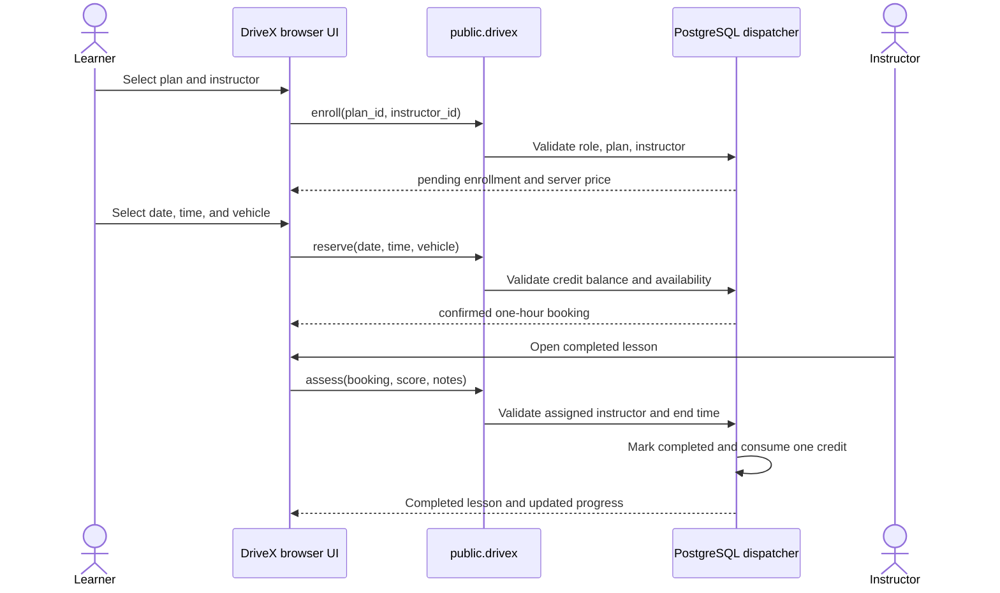
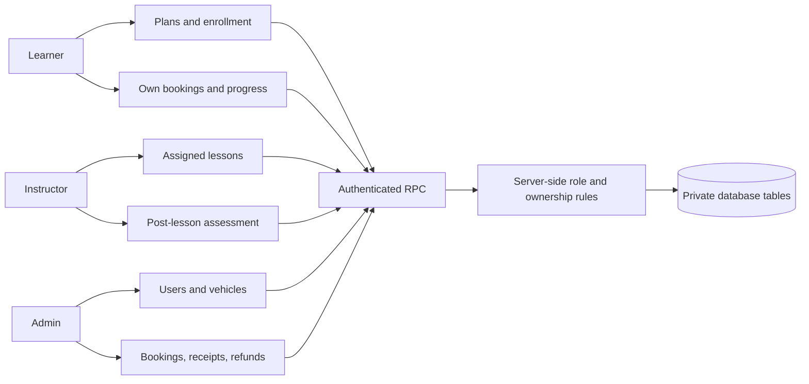

# DriveX Master Project Document

DriveX is a driving-school management web application for learners, instructors, and administrators. It supports account authentication, instructor and vehicle management, lesson reservations, plan credits, lesson assessment, learning progress, and payment records.

This document is the project-level guide for understanding, developing, testing, and deploying DriveX.

## 1. Product Scope

### User roles

| Role | Capabilities |
| --- | --- |
| Learner | Create an account, choose a plan, view remaining credits, reserve lessons, cancel eligible lessons, view progress, and view payment history |
| Instructor | View assigned confirmed or completed lessons, access relevant learner contact information, and assess completed lessons with a score and notes |
| Administrator | Manage instructors and vehicles, view bookings, record received payments, process refund records, and manage operational data |

### Business rules

- Plans, not individual lesson prices, are the primary product model.
- The seeded plans are `10-Day Plan` at INR 1,500 for 10 credits and `Monthly Plan` at INR 4,000 for 30 credits.
- One credit is consumed when a practical lesson is completed.
- A lesson is one hour long and can be reserved up to 90 days in advance.
- Available lesson times are 08:00, 09:00, 10:00, 11:00, 14:00, 15:00, 16:00, and 17:00 in India Standard Time.
- Pending reservations expire after 30 minutes.
- A learner, instructor, or vehicle cannot be double-booked for overlapping active lessons.
- Instructor scores range from 1 to 10 and require notes between 1 and 1,500 characters.
- Roles and prices are decided by the server. The browser cannot promote users, change prices, or mark its own payments as paid.

## 2. Architecture



### Request flow

1. The browser authenticates with Supabase Auth using email and password.
2. The browser stores only the current auth session in `sessionStorage`.
3. Authenticated domain operations call the single `public.drivex(action, payload)` RPC.
4. The public RPC delegates to the private `drivex_private.dispatch` function.
5. The dispatcher resolves the caller with `auth.uid()`, reads the protected role, validates ownership and permissions, and performs the transaction.
6. Payment webhooks use the service-only `confirm_payment_server` RPC after signature validation.

The browser does not query or mutate application tables directly.

### Application layers

| Layer | Components | Responsibility |
| --- | --- | --- |
| Presentation | `dist/index.html`, `dist/app.mjs`, `dist/styles.css` | Renders authentication, learner, instructor, and administrator screens; collects user input; displays loading, empty, success, and error states |
| Client API | `dist/api.mjs`, `dist/config.mjs` | Manages the auth session, refreshes tokens, calls Supabase Auth, invokes the RPC dispatcher, and invokes Edge Functions |
| Public API boundary | `public.drivex(action, payload)` | Exposes one authenticated application entry point and prevents direct table access from the browser |
| Authorization and domain logic | `drivex_private.dispatch` | Resolves the authenticated user, checks role and ownership, validates payloads, applies business rules, and performs atomic writes |
| Persistence | Supabase PostgreSQL and `drivex_private` tables | Stores identities, plans, enrollments, bookings, payments, vehicles, and learning progress; enforces relational and concurrency constraints |
| Integration services | Supabase Edge Functions and Razorpay | Handles server-only payment order creation and signed payment webhooks when online checkout is enabled |
| Hosting | Render static web service | Installs dependencies, generates public configuration, serves `dist/`, rewrites application routes, and adds security headers |

### Learner booking and credit flow



### Role boundaries



### Optional online payment flow

Online checkout is separate from the current manual receipt workflow. When enabled, the intended architecture is:

```mermaid
sequenceDiagram
    actor Learner
    participant UI as DriveX browser
    participant Create as create-order Edge Function
    participant RZP as Razorpay
    participant Hook as razorpay-webhook Edge Function
    participant DB as confirm_payment_server RPC

    Learner->>UI: Start payment for enrollment
    UI->>Create: Send authenticated enrollment request
    Create->>DB: Verify enrollment through authenticated RPC
    Create->>RZP: Create INR order using server secret
    RZP-->>UI: Checkout order
    RZP->>Hook: Send signed payment webhook
    Hook->>Hook: Verify HMAC-SHA256 signature
    Hook->>DB: Confirm payment with service role and event ID
    DB-->>Hook: Idempotent payment result
```

The browser must never receive the Razorpay secret or the Supabase service-role key. Payment confirmation must remain server-side and idempotent.

## 3. Technology and Dependency Inventory

### Runtime dependencies

| Dependency or service | Where used | Purpose |
| --- | --- | --- |
| Modern browser ES modules | `dist/*.mjs` | Frontend application modules without a framework or bundler |
| Browser `fetch` API | `dist/api.mjs` | Calls Supabase Auth, PostgREST RPC, and Edge Functions |
| Browser `sessionStorage` | `dist/api.mjs` | Stores the active auth session only |
| Supabase Auth | Supabase project | Signup, email confirmation, login, refresh, password recovery, password change, and logout |
| Supabase Postgres | Supabase project | Persistent profiles, vehicles, bookings, payments, plans, enrollments, and progress data |
| Supabase Edge Runtime / Deno | `supabase/functions/*` | Server-side payment order creation and webhook handling |
| Razorpay HTTP API | `create-order/index.ts` | Payment-order creation when online checkout is enabled |
| Web Crypto API | `supabase/functions/_shared/crypto.mjs` | HMAC-SHA256 Razorpay webhook signature validation |
| Python 3 `http.server` | `npm start` and `npm run dev` | Local static-file server for `dist/` |

### Node and test dependencies

The project has one declared npm package dependency:

| Package | Version | Scope | Purpose |
| --- | --- | --- | --- |
| `@electric-sql/pglite` | `0.3.14` | Development/test | Runs PostgreSQL-compatible integration tests locally in Node and provides the `btree_gist` test extension |

The test suite also uses Node 20+ built-ins:

- `node:test` for test definitions and subtests.
- `node:assert/strict` for assertions.
- `node:fs/promises` for loading migrations.
- Native ESM through `"type": "module"` in `package.json`.

There is no React, Vue, Angular, Tailwind, Bootstrap, frontend bundler, or browser JavaScript CDN dependency in the current application. Google Fonts is optional; system fonts remain the fallback.

### Infrastructure and tooling

- Node.js 20 or newer for scripts and tests.
- Python 3 for local static hosting.
- Supabase CLI for database migrations and local Supabase workflows.
- Render static-site hosting using `render.yaml`.
- Supabase CLI-managed Postgres major version 15 locally, as declared in `supabase/config.toml`.

## 4. Repository Map

| Path | Responsibility |
| --- | --- |
| `dist/index.html` | Browser entry page |
| `dist/app.mjs` | Role-specific screens, forms, loading states, empty states, and error handling |
| `dist/api.mjs` | Supabase Auth, authenticated RPC, and Edge Function client |
| `dist/config.mjs` | Generated public Supabase URL and publishable key |
| `dist/config.example.mjs` | Example public configuration shape |
| `dist/styles.css` | Responsive application styling |
| `scripts/generate-config.mjs` | Validates environment variables and writes `dist/config.mjs` |
| `backend/schema.sql` | Reproducible initial database schema and authorization dispatcher |
| `backend/bootstrap-admin.sql` | Owner-controlled first administrator promotion |
| `supabase/migrations/` | Ordered schema changes; every applied change gets a new migration |
| `supabase/functions/create-order/` | Razorpay order creation Edge Function |
| `supabase/functions/razorpay-webhook/` | Razorpay webhook verification and server-side payment confirmation |
| `supabase/functions/_shared/crypto.mjs` | Shared HMAC webhook verification helper |
| `supabase/verify.sql` | SQL checks for important deployed schema objects and seed data |
| `tests/database.test.mjs` | PGlite integration and authorization tests |
| `tests/razorpay.test.mjs` | Razorpay-related tests |
| `render.yaml` | Render static hosting, build command, rewrites, security headers, and environment variables |
| `API_CONTRACT.md` | RPC actions, payloads, responses, roles, and errors |
| `README.md` | Current operational status and quick-start notes |

## 5. Database and Security Model

Application tables live in the non-exposed `drivex_private` schema. The main data areas are:

- `profiles`: authenticated user identity, role, phone, specialty, and approval state.
- `vehicles`: active training vehicles and transmission type.
- `bookings`: learner, instructor, vehicle, time range, status, score, and notes.
- `payments`: payment receipt references, refund references, and payment status.
- Plan and enrollment tables introduced by the later migrations store credit balances and learner enrollment state.

Security controls include:

- Row-level security enabled on private application tables.
- No direct browser table privileges for `public`, `anon`, or `authenticated`.
- Authenticated access limited to the bounded `public.drivex` dispatcher.
- Role lookup from protected database rows on every request, rather than trusting client metadata or stale role claims.
- Empty `search_path` and schema-qualified objects in the security-definer dispatcher.
- PostgreSQL GiST exclusion constraints for overlapping learner, instructor, and vehicle bookings.
- Server-authoritative prices, roles, payment status, and credit consumption.
- Idempotent payment confirmation using provider event IDs.

Never put a service-role key, Razorpay secret, webhook secret, or database password in `dist/`, Git, or client configuration.

## 6. Configuration

### Frontend and Render variables

| Variable | Required | Where | Description |
| --- | --- | --- | --- |
| `SUPABASE_URL` | Yes | Local shell or Render | Supabase project URL, such as `https://<project-ref>.supabase.co` |
| `SUPABASE_PUBLISHABLE_KEY` | Yes | Local shell or Render | Public browser key; an older `SUPABASE_ANON_KEY` name is accepted by the generator as a fallback |

`npm run build` writes these values to `dist/config.mjs`. The build script rejects empty, malformed, or service-role keys.

### Edge Function secrets

These belong only in Supabase Function secrets when the Razorpay integration is enabled:

- `SUPABASE_URL`
- `SUPABASE_ANON_KEY`
- `SUPABASE_SERVICE_ROLE_KEY`
- `RAZORPAY_KEY_ID`
- `RAZORPAY_KEY_SECRET`
- `RAZORPAY_WEBHOOK_SECRET`

The current README states that online checkout is not connected and that school staff record actual receipts manually. The Edge Functions are payment integration code present in the repository, but enabling them requires completing provider configuration, deployment, webhook registration, and end-to-end verification.

## 7. Local Development

Prerequisites: Node.js 20+, Python 3, and access to the configured Supabase project for live auth/data flows.

```sh
npm ci
npm run build
npm test
npm run check
npm start
```

Open `http://localhost:3000` after starting the server.

Useful scripts:

| Command | Purpose |
| --- | --- |
| `npm run build` | Generate `dist/config.mjs` from environment variables or local `.env` |
| `npm test` | Run Node/PGlite database and payment tests |
| `npm run check` | Run Node syntax checks on frontend modules |
| `npm start` | Serve `dist/` locally on port 3000 |
| `npm run dev` | Same local static server command as `npm start` |
| `npm run db:push` | Apply Supabase migrations; use the repository safety procedure before running against a shared project |
| `npm run db:diff` | Generate a Supabase database diff |

## 8. Deployment Flow

### Render frontend

`render.yaml` configures a static web service named `drivex`:

1. Install dependencies with `npm ci`.
2. Generate the public frontend config with `node scripts/generate-config.mjs`.
3. Publish the `dist/` directory.
4. Rewrite all routes to `index.html`.
5. Apply MIME, referrer, and Content Security Policy headers.

Set `SUPABASE_URL` and `SUPABASE_PUBLISHABLE_KEY` as Render environment variables. Do not commit generated secrets or replace the publishable key with a service-role key.

### Supabase project

1. Apply the ordered migrations to a fresh project, or use the already-configured project without reapplying its initial schema.
2. Configure the Auth Site URL to the deployed frontend URL.
3. Add `http://localhost:3000` for local redirect testing.
4. Keep email confirmation enabled and configure SMTP for reliable signup and password reset delivery.
5. Create and confirm the owner account.
6. Run `backend/bootstrap-admin.sql` with the verified Auth user UUID.
7. Create instructor accounts, promote them through the admin workflow, and add real vehicles.

Never run a destructive database reset or rewrite an applied migration without explicit approval. Schema changes must be new files under `supabase/migrations/`.

## 9. Testing and Verification

The local test suite exercises the schema and dispatcher in PGlite with isolated test-only Auth fixtures. Important coverage includes:

- Initial empty state and plan prices.
- Instructor approval and role authorization.
- Enrollment and server-controlled amounts.
- Payment authorization and credit activation.
- Lesson reservations and overlap rejection.
- Lesson completion and credit consumption.
- Theory and practical progress permissions.
- Cancellation, refund records, expiry, idempotency, and anonymous access denial.

Before handing off a change, run:

```sh
npm test && npm run check
```

Local tests do not prove that Supabase-hosted Auth, SMTP, deployed Edge Functions, live PostgREST grants, Razorpay webhooks, browser rendering, or cross-session concurrency are working. Those require separate environment-level verification.

## 10. Development Rules

- Keep all data access behind `public.drivex(action, payload)`.
- Treat the server as authoritative for roles, prices, payments, bookings, and credits.
- Add a new migration file for every schema change; do not edit an applied migration.
- Add or update tests for each behavior change.
- Keep secrets out of frontend code, source control, logs, and chat.
- Preserve the distinction between recorded school receipts and real online payment processing.
- Update `API_CONTRACT.md` when RPC actions or payloads change.
- Keep `README.md` and this document honest about what is locally tested, deployed, or still unverified.

## 11. Current Gaps and Next Work

- Configure and verify Supabase Auth Site URL, redirect URLs, SMTP, and email confirmation in the live project.
- Complete a real signup, confirmation, login, booking, instructor assessment, and administrator workflow in the deployed environment.
- Decide whether the Razorpay Edge Functions are production scope or should remain dormant payment-integration code.
- If Razorpay is enabled, configure secrets, deploy both functions, register the webhook, verify signature handling, and test idempotent payment confirmation.
- Add browser-level visual and interaction checks if the deployment workflow requires UI regression coverage.
- Keep the API contract, migrations, tests, and operational documentation synchronized as features evolve.