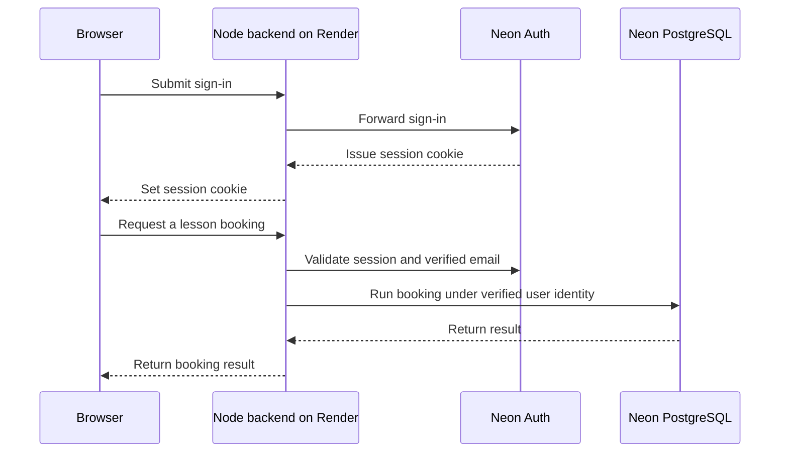

# DriveX: Neon Auth and PostgreSQL Implementation

**Status as of November 12, 2026:** The code is in [draft PR #4](https://github.com/ANTOJERRIN/DriveX/pull/4). GitHub CI passed. The Neon version has not been deployed, and the live Render site has not switched providers.

## Architecture

## Authentication

- The browser calls the same-origin Node backend for signup, sign-in, sign-out, session restoration, and password reset.
- On protected requests, the backend checks the session with Neon Auth and requires a verified email.
- The backend maps the verified Neon user ID to a stable DriveX UUID. The browser cannot choose the identity used for database operations.
- The database determines whether the user is a learner, instructor, or admin. New accounts start as learners. An admin assigns instructor access, and the first administrator is set up explicitly.

## Database

- The migration runner prepares a fresh Neon database using the existing DriveX SQL migrations. It skips the scheduler that depends on Supabase-specific services.
- The backend uses a restricted database login and sets the verified user identity for the current transaction only. The browser never receives the connection string.
- The existing `drivex(action, payload)` dispatcher applies role and ownership checks and preserves the plan, credit, booking, and receipt rules.
- **Example:** Booking a lesson reserves a credit. Completing it spends the credit. Cancelling releases it. PostgreSQL constraints prevent overlapping bookings.
- Administrators can record actual payment receipts. Razorpay checkout and the notification worker still need migration.

## Code map

| File | Responsibility |
| --- | --- |
| `dist/neon-api.mjs` | Browser authentication and API requests |
| `backend/neon/server.mjs` | Same-origin auth routes, session checks, and application API |
| `backend/neon/gateway.mjs` | Identity mapping and transaction-scoped database access |
| `backend/neon/bootstrap.sql` | Compatibility objects for existing SQL migrations |
| `backend/neon/migrate.mjs` | Applies and tracks database migrations |
| `backend/neon/runtime-grants.sql` | Permissions for the restricted database login |
| `tests/neon.test.mjs` | Migration replay, identity separation, and access checks |
| `render.neon.yaml` | Separate Render staging service configuration |

## Validation and next steps

**Passed:** 98 local tests, syntax checks for 47 JavaScript modules, and [GitHub CI](https://github.com/ANTOJERRIN/DriveX/actions/runs/42958393726). The new tests cover migration replay, rejection of unverified identities, separation between accounts, and denial of admin actions to learners.

**Still pending:** Live Neon sign-in, email confirmation, password reset, and booking on Render. Existing Supabase accounts and records have not been imported.

1. Create a dedicated Neon staging project, enable Neon Auth, and add the Render staging origin to its trusted domains.
2. Apply the database migrations and create the restricted runtime login. Keep the migration owner and runtime connection strings separate.
3. Deploy the staging service with `APP_ORIGIN`, `NEON_AUTH_URL`, and the restricted `DATABASE_URL` configured in Render.
4. Test account confirmation, sign-in, reset, role access, and the full lesson lifecycle before switching production. Plan existing-data recovery, Razorpay, and notifications separately.

For exact setup commands, see the [repository migration guide](https://github.com/ANTOJERRIN/DriveX/blob/feat/neon-auth-postgres/docs-neon-migration.md).
